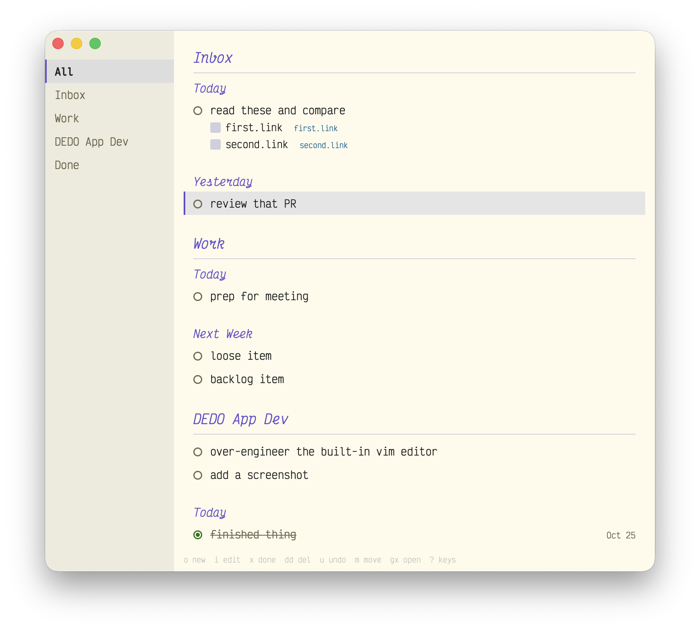

# DEDO

**De**von's To-**Do** List App (pronounced "dee doo")

A keyboard-only macOS to-do list that works as a friendly app front-end to a simple TODO list in a markdown file. It is vim-friendly, coding-agent-friendly, and most importantly, me-friendly.

*This codebase is 100% vibecoded slop.*



## Settings

Settings live in `~/.config/dedo/config.toml`.

| Setting | Behavior | Default |
|---------|----------|---------|
| `file`  | File path of `DEDO.md`. `~` works. | `~/Library/Mobile Documents/com~apple~CloudDocs/DEDO.md` |
| `git`   | `"sync"`: commit the list file (only that file), pull, and push while the app runs. | off |
| `git_every` | How often to sync (minimum 30s).  | `"5m"` |
| `new_items` | Where new items go: `top` or `bottom`. | `"top"` |
| `appearance` | `system`, `light`, or `dark`. | `"system"` |
| `[dark]`, `[light]` | `"#rrggbb"` for `background`, `sidebar`, `text`, `muted`, `selection`, `accent`, `done`, `link`, `error`. | Dracula, Alucard |

### iCloud Sync

The default sync path is the iCloud Drive folder (`DEDO.md` ) and iCloud handles all the syncing.

### Git Sync

If the file is in a git repo, add `git = "sync"`. While the app runs, the repo is pulled, merged, committed, and pushed in the background. By default, the list syncs every 5 minutes, whenever the app comes into focus, or out of focus after changes, and on quit.

## Example `DEDO.md`

All state for DEDO lives in a single edit-friendly `.md` file.

```markdown
# Inbox

## 2026-10-25
- [ ] read these and compare
  - https://first.link
  - https://second.link

## 2026-10-24
- [ ] review that PR

# Work

## Today

- [ ] prep for meeting

## Next Week

- [ ] loose item
- [ ] backlog item

# DEDO App Dev
- [ ] over-engineer the built-in vim editor
- [ ] add a screenshot

## Today
- [x] finished thing @done(2026-10-25 14:32)

## This Week

# Done
- [x] older thing @done(2026-10-24 09:10)
```

- `#` headings are folders (the sidebar). **All** shows every folder except Done the same way, sections included.
- `##` headings are sections inside a folder. Inbox groups items by the day they were added.
- New items go at the top of their list (`new_items = "bottom"` for the bottom). Done is always newest first.
- Checked-off items stay crossed out until the next 6am, then move to `# Done`.
- Anything DEDO doesn't model (prose, nested lists) is left alone.

### Keyboard Shortcuts

Press `?` in the app for every key. The common ones:

| key | |
|---|---|
| `j` `k` `gg` `G` | move |
| `o` / `O` | new item in this list / above the cursor. Enter adds another, Esc finishes |
| `i` `A` / Enter, `I` | edit title, cursor at the end / start (pasted URLs become sub-items) |
| `x` / Space | check off or reopen |
| `dd` / `u` | delete / undo |
| `m` | move to a folder or section: `j` `k` or type, Enter |
| `gx` | open the item's links |
| `gt` `gT`, `Cmd }` `Cmd {` | next / previous folder |
| `Cmd N`, `Cmd O` | new item in Inbox |
| `Cmd E` | edit the whole file with vim keys, starting at the item; `:wq` returns |

Drag items to reorder them or onto a folder or section header to move them; drag folders to reorder them.

## `dedo` for scripts and AI agents

```sh
dedo add "Read this and summarize" --link=example.com    # Inbox, today
dedo add --folder=Wedding --section=Today "Call the florist"
dedo complete --folder=Wedding "florist"
dedo create-folder Wedding
dedo list --folder=Wedding
dedo lint        # after editing the file by hand
dedo path        # where the file is
dedo help
```

## Build

`./bundle.sh` builds `DEDO.app` and links `~/.local/bin/dedo`. `/Applications/DEDO.app` is a symlink to the
build here, so it's always the latest (and breaks if this drive isn't mounted). `swift run DEDOApp` for dev, `swift test` for tests.

The editor is [VimKit](VimKit/README.md), a separate local package meant for reuse in other Mac apps
(`swift test --package-path VimKit` for its tests).
